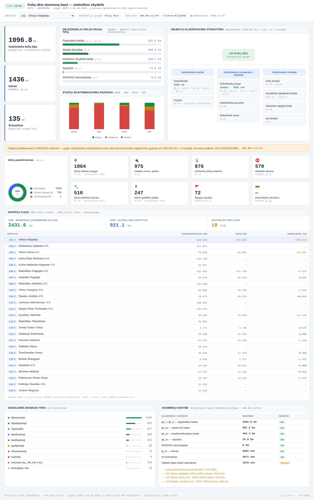

# GITS · Kelių ūkio statistikos skydelis

Statistikos skydelis Lietuvos geležinkelių **Kelių ūkio duomenų bazei** (GITS / GEOSECMA, `vdm_dev.silver`).
Python generatorius iš vieno JSON failo sukuria savarankišką HTML puslapį, kurį GitHub Actions automatiškai publikuoja į GitHub Pages.

Dalis **InfraMap** platformos · LTG Infra.



## Ką rodo

- **KPI** — kelių ilgis (km), iešmai, šviesoforai; filtruojama pagal 25 kryptis (L01–L25)
- **Keliai pagal tipą** — GKODAS: `gk_I/gk_II`, `gk_kt`, `gk_ai`, `gk_sv`
- **Stočių skaitmenizavimo pažanga** — GEOD, DWG, ORTO, SAP
- **Objektų klasifikavimo struktūra** — pagal Kelių ūkio DB reglamentą (galioja nuo 2010‑06‑01)
- **VDM ir GIPS krypčių ilgių palyginimas** su skirtumų stulpeliu
- **Signalinės įrangos tipai** ir **duomenų kokybės** lentelė
- **Automatiniai nuoseklumo patikrinimai** — neatitikimai rodomi build metu ir pačiame skydelyje

Pasirinkta kryptis išsaugoma URL (`?kryptis=L01`), todėl nuoroda į konkrečią kryptį dalinama tiesiogiai. Palaikoma tamsi tema.

## Paleidimas

```bash
pip install -e ".[dev]"

gits-dashboard check          # patikrina duomenų nuoseklumą
gits-dashboard build          # sugeneruoja dist/index.html ir dist/kryptys.csv
gits-dashboard serve          # peržiūra http://localhost:8000
```

Arba per `make`: `make build`, `make test`, `make serve`.

## Struktūra

```
data/dashboard.json              visi skydelio duomenys — keičiama tik čia
src/gits_dashboard/
  models.py                      duomenų modelis ir nuoseklumo patikrinimai
  build.py                       HTML ir CSV generavimas
  __main__.py                    CLI: build / check / serve
  templates/index.html           HTML šablonas
  static/style.css, app.js       stilius ir krypčių filtras naršyklėje
tests/                           pytest
.github/workflows/pages.yml      lint → testai → build → GitHub Pages
```

## Duomenų atnaujinimas

1. Pakeisk reikšmes `data/dashboard.json`
2. `gits-dashboard check` — parodys, jei krypčių sumos nesutampa su suvestine
3. Commit + push į `main` — puslapis atsinaujina automatiškai

## GitHub Pages įjungimas

Repozitorijoje: **Settings → Pages → Source: GitHub Actions**.

> ⚠️ GitHub Pages puslapis yra viešas net iš privačios repozitorijos (išskyrus GitHub Enterprise Cloud).

## Šaltiniai

- GKTR 2.16.01:2002 „Lietuvos geležinkelio GIS specifikacija"
- Geležinkelių infrastruktūros Kelių ūkio duomenų bazės reglamentas (2010‑06‑01), 1–6 priedai
